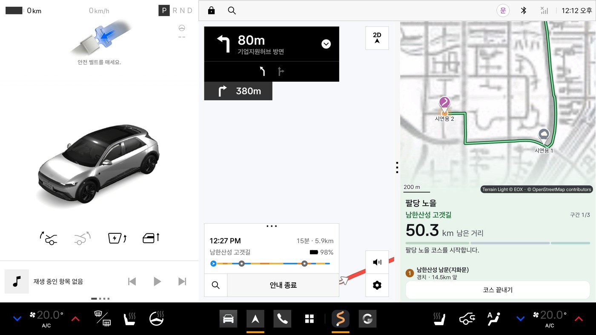
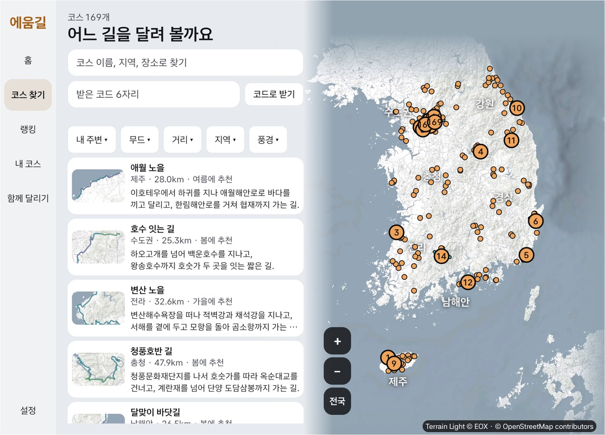
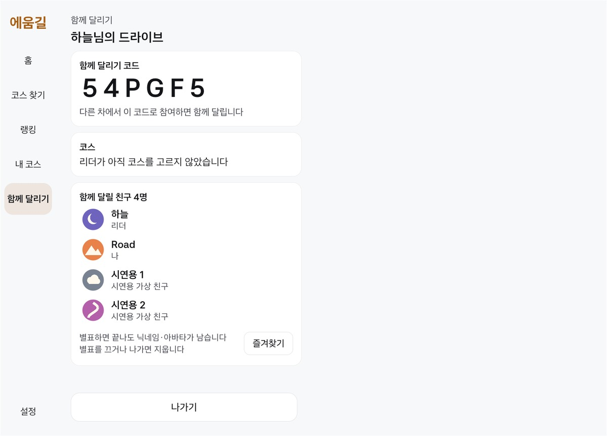
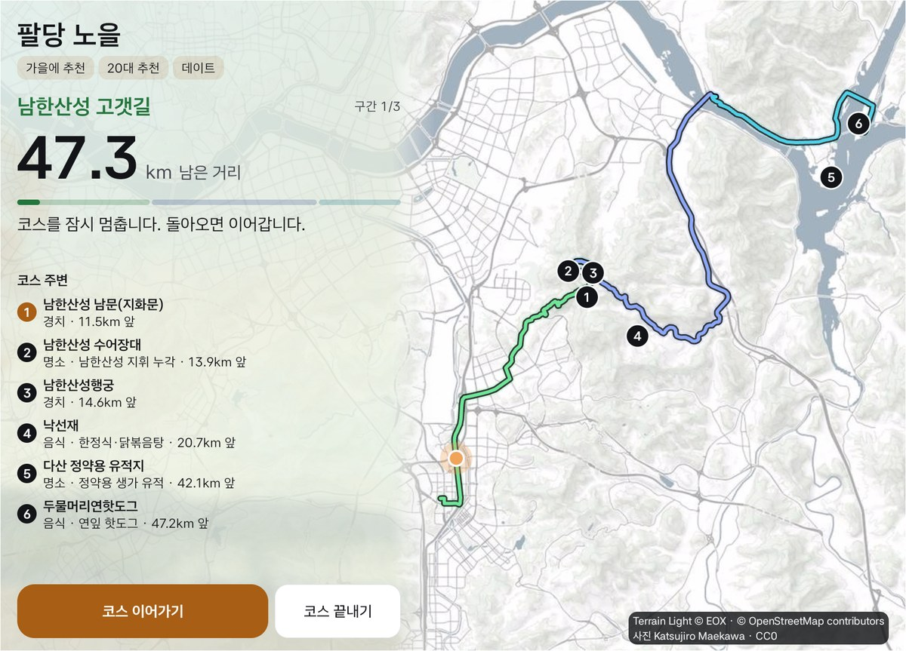
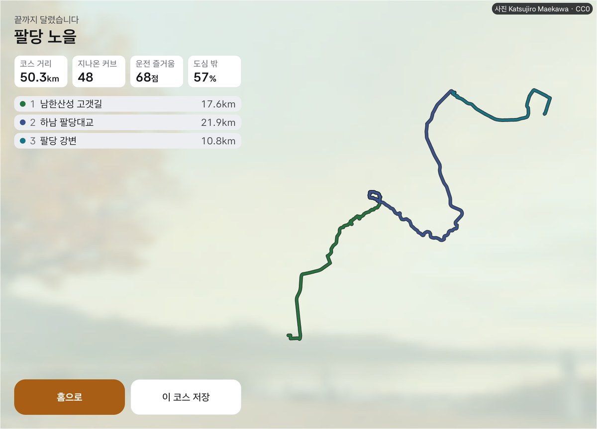
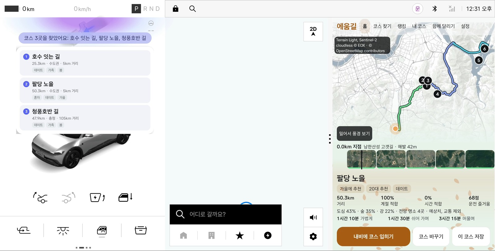

# 에움길 (Byway) — Pleos 드라이빙 코스 앱

> **에움길:** 빙 둘러서 가는 굽은 길.

현대차그룹 차량용 앱 개발 공모전 출품작입니다. Pleos Connect(Android Automotive, API 34)에서 돌아갑니다.

> 드라이빙 코스를 차의 내비에 그대로 입히는 앱. 최단 경로가 아니라, 그 길을 달리게 합니다.



## 무엇을 하나

내비는 목적지까지 가장 빠른 길을 찾습니다. 드라이브는 반대입니다. 가고 싶은 길이 먼저 있고, 목적지는 그 길의 끝일 뿐입니다. 에움길은 정해 둔 코스를 차의 내장 내비가 그대로 따라가게 만듭니다.

- 코스를 구간으로 나누고, 구간마다 경유지 열로 바꿔 내비에 올립니다.
- 달리는 동안 다음 구간으로 경로를 이어 붙입니다.
- 코스를 벗어나면 "잠깐 들르는지, 돌아갈지"를 묻고, 돌아가는 길을 안내합니다.
- 내비 화면은 차의 내장 내비를 그대로 씁니다. 에움길은 남은 거리, 구간, 코스 주변 볼거리를 보여 줍니다.

## 기능

| 기능 | 내용 |
|---|---|
| **홈** | 차 위치와 계절·시간에 맞는 코스를 추천합니다. 거리, 계절·시간 적합도, 운전 즐거움 점수, 예상 소요 시간, 코스 주변 장소를 보여 줍니다 |
| **코스 찾기** | 이름·지역·장소 검색, 내 주변·무드·거리·지역·풍경으로 걸러 보기, 지도와 목록. 받은 6자리 코드로 다른 사람의 코스를 받습니다 |
| **랭킹** | 커브 수, 운전 즐거움, 자연 풍경 비율, 거리 기준 순위 |
| **내 코스** | 저장한 코스와 직접 달려 기록한 코스. 기록한 코스는 링크·전체·함께 달리는 친구 범위로 공유합니다 |
| **코스 주행** | 구간별 경로 올리기, 구간 안내와 볼거리 음성 안내, 이탈 질문과 복귀 안내, 일시정지와 이어가기, 달리다 만 코스 이어가기, 완주 요약 |
| **출발 화면 고르기** | 3분할(내비 가운데 또는 에움길 가운데)과 2분할(내비 넓게) 중에 골라 출발합니다 |
| **함께 달리기** | 코드로 친구를 모으고 리더가 코스를 고릅니다. 친구는 승낙하거나 거부합니다. 달리는 동안 서로의 위치를 확대 지도에 보여 줍니다 |
| **Gleo 음성 연동** | "노을 보기 좋은 코스 찾아줘", "팔당 노을로 출발해줘", "잠깐 들를게", "얼마나 남았어?" 같은 말로 찾기·출발·주행 중 조작을 합니다 |
| **차 안 연출** | 구간 분위기에 맞춰 공조·조명·창문을 바꿉니다(설정에서 끌 수 있음) |
| **낮·밤, 일반 지도·위성** | 차의 주야간 모드를 따르고, 지도 종류를 설정에서 고릅니다 |

| 코스 찾기 | 함께 달리기 |
|---|---|
|  |  |

| 일시정지 | 완주 요약 |
|---|---|
|  |  |

### 주행 규제

- 코스 고르기, 검색, 공유, 함께 달리기 모으기는 **기어가 P일 때만** 됩니다.
- P가 아니면 주행 화면과 대기 화면만 나옵니다. 화면을 정하는 곳은 `app/.../ui/Screen.kt`의 `screenFor` 하나입니다.
- 주행 중에 새 코스를 출발시키는 방법은 음성(Gleo)뿐입니다.

### Gleo 음성 연동

Gleo AI가 읽는 `app/src/main/assets/schema.json`에 함수 3개를 적었습니다(Pleos 규칙상 앱당 최대 3개).

| 함수 | 부르는 방식 | 하는 일 |
|---|---|---|
| `FIND_DRIVING_COURSES` | 방송 | 검색어, 무드, 내 주변 거리, 코스 거리, 지역, 랭킹 기준, 내 코스로 찾아 앞의 3개를 돌려줍니다 |
| `START_DRIVING_COURSE` | 화면(투명) | 코스 이름, 직전 찾기 결과의 순위, 이어 달리기로 출발합니다. 에움길이 내비 뒤에 가려져 있어도 출발합니다 |
| `CONTROL_BYWAY_DRIVE` | 방송 | 잠깐 들르기·복귀, 코스 끝내기, 남은 거리, 다음 볼거리, 음성 안내와 차 안 연출 켜기·끄기, 기록 그만, 위치 공유 끄기 |



- 실제 Gleo 연동은 Pleos의 스키마 승인이 있어야 켜집니다. 지금은 스키마 작성과 수신부 구현까지 끝난 상태입니다.
- 위 그림과 시연 영상의 Gleo 화면은 **시연용 모듈 `gleosim`** 이 그린 것입니다. 같은 규격의 호출을 에움길에 보내고 답을 받아 보여 줍니다. 실제 Gleo가 아니며, 제출 APK에는 들어 있지 않습니다.
- 설계와 에뮬레이터 실측은 `docs/superpowers/specs/2026-11-13-gleo-voice-design.md`에 있습니다.

## 코스

기기에 든 코스는 15개입니다. 도로 좌표는 OpenStreetMap에서 뽑아 구간으로 나눴습니다.

애월 노을, 호수 잇는 길, 변산 노을, 청풍호반 길, 달맞이 바닷길, 감포 가는 길, 화담숲 가는 길, 광교산 자락길, 1100도로 숲길, 헌화로 바닷길, 만항재 고갯길, 물미 해안길, 팔당 노을, 섬진강 물길, 남한강 물길

- 코스 찾기와 랭킹에는 화면을 채우는 **더미 코스 150개**가 함께 나옵니다. 이름과 좌표만 있는 자리 표시이고, 화면에 더미라고 적혀 있습니다.
- 에뮬레이터의 내비 위치가 판교로 고정되어 있어 주행 시연은 판교에서 출발하는 **팔당 노을**(50.3km, 구간 3개)로 합니다.
- 코스 만들기는 `tools/make-course.py`, 형식은 `docs/제작가이드.md` 9장을 봅니다.

## 실행

제출 APK는 `apk/byway_에움길_release.apk`입니다(release 서명, 태그 `submit-20261115`).

```bash
adb install -r apk/*_release.apk
adb shell pm grant --user 10 com.byway pleos.car.permission.FUSED_LOCATION
adb shell am start --user 10 -n com.byway/.ui.MainActivity
```

1. 기어를 P에 둡니다. 홈에 추천 코스가 나옵니다.
2. "내비에 코스 입히기"를 누르고 출발 화면을 고릅니다.
3. 차 내비에 코스 첫 구간이 올라가고 안내가 시작됩니다.

**제출 APK에는 공유 서버 주소가 없습니다.** 그래서 코스 공유와 함께 달리기는 "공유 서버에 연결할 수 없습니다" 안내로 나오고, 기기에 든 코스는 그대로 쓸 수 있습니다. 두 기능을 보려면 아래처럼 서버를 띄우고 주소를 넣어 빌드합니다.

## 빌드와 시험

JDK 21, Android SDK 34, Gradle 8.9(래퍼 포함)가 필요합니다.

```bash
# 단위 시험
./gradlew :core:test :server:test :app:testDebugUnitTest :gleosim:testDebugUnitTest

# APK
./gradlew assembleDebug      # app/build/outputs/apk/debug/
./gradlew assembleRelease    # 서명 설정 ~/.byway/release.properties 필요
```

제출 시점의 시험 수는 core 340, server 48, app 375, gleosim 13이고 모두 통과합니다.

### 공유 서버와 함께 쓰기

```bash
tools/run-server.sh demo     # 서버를 띄운다. demo 는 새 함께 달리기에 가상 친구 2명을 넣는다
./gradlew assembleRelease -Pbyway.serverUrl=http://<서버 주소>:8787
```

- 서버는 Ktor와 SQLite로 만든 작은 서버입니다(`server/`). 코스 공유, 6자리 코드, 함께 달리기, 위치 공유를 맡습니다.
- 서버 주소는 빌드할 때만 넣습니다. 저장소와 제출 APK에는 주소를 두지 않습니다.
- 위치는 함께 달리는 동안에만 2초마다 보내고, 서버는 60초가 지난 위치를 지웁니다. 코스를 끝내면 바로 멈춥니다.

### 에뮬레이터

- Pleos Connect 에뮬레이터(AVD `Pleos_Connect`, API 34, 2560×1440)에서 확인했습니다.
- 창 크기는 2/3 창, 3분할의 1/3 칸, 전체 화면(보조 화면)이고, 낮·밤 모두 봤습니다.
- 기어와 속도는 에뮬레이터의 Virtual Console로 바꿉니다(`adb forward tcp:8088 tcp:8088`). `tools/record-demo.sh`를 참고하세요.
- 여러 작업이 같은 에뮬레이터를 쓰므로 `tools/emulator-lock.sh`로 잠그고 씁니다.

## 저장소 구조

```
core/       코스 엔진과 판단. 순수 Kotlin, Android 의존성 없음
  course/   코스·구간 모델과 읽기
  engine/   주행 엔진: 구간 교체, 이탈·복귀, 일시정지, 완주
  drive/    엔진이 받는 사건과 내는 명령(계약)
  geo/      거리·좌표 계산
  share/    공유·함께 달리기 규칙
  gleo/     Gleo 함수별 판단과 답 모양
  record/   직접 달린 길 기록
app/        Android 앱
  platform/ Pleos SDK 어댑터(내비, 위치, 기어, 음성, 공조·조명·창문, Gleo 답). ai.pleos.* import 는 여기에만 둔다
  service/  주행 서비스, 코스 목록, 공유 동기화, 함께 달리기 감시, Gleo 수신
  ui/       화면. 뷰를 코드로 그린다(XML 레이아웃 없음)
feature/    부가 기능. 기능 하나가 모듈 하나(ambience 차 안 연출, guide 안내, music)
server/     공유·함께 달리기 서버(Ktor, SQLite)
gleosim/    시연용 Gleo 화면. 제출 APK 와 별개
tools/      코스·지도·그림 만들기, 시연 녹화, 서버 실행, 에뮬레이터 잠금
docs/       제작 가이드, 개발 계획서, 권리 점검, 기능별 설계(superpowers/specs)
apk/        제출용 release APK
```

- 구조와 규칙은 `docs/제작가이드.md`에 있습니다. 엔진은 사건을 받아 명령을 내는 순수 함수라, 차 없이 단위 시험으로 주행 장면을 확인합니다.
- 기능별 설계는 `docs/superpowers/specs/`에 날짜순으로 있습니다(앱 구조, 디자인, 공유, 주행 3분할, 코스 찾기, 함께 달리기, 출발 화면, Gleo).

## 쓰는 Pleos 기능

| 권한 | 쓰는 곳 |
|---|---|
| `NAVI_ROUTE`, `NAVI_ROUTE_SEARCH` | 구간 경유지로 경로 요청, 안내 시작·취소 받기 |
| `FUSED_LOCATION` | 코스 진행, 이탈·복귀 판단, 내 주변 코스, 함께 달리기 위치 |
| `CAR_DRIVE` | 기어(P 여부)로 주행 규제 |
| `TTS_SERVICE` | 구간·볼거리·이탈 음성 안내 |
| `CAR_CLIMATE`, `CAR_LIGHTS`, `CAR_WINDOWS`(읽기·제어) | 차 안 연출과 끝난 뒤 되돌리기 |
| `CAR_ENERGY` | 평균 연비·전비를 읽어 코스에 드는 연료량 어림. 값을 주지 않는 차와 에뮬레이터에서는 그 칸을 숨깁니다 |

SDK는 `ai.pleos.playground:Vehicle:2.3.2`이고, minSdk 28, targetSdk 34, 언어는 Kotlin입니다.

## 알려진 한계

- 실차에서 확인하지 못했습니다. 에뮬레이터에서만 확인했습니다.
- 실제 Gleo 연동은 스키마 승인 전입니다. 한국어 인자 전달, 답 음성, 출발 화면 호출은 승인 뒤 확인이 필요합니다.
- 에뮬레이터 내비가 판교에 고정되어 있어 다른 지역 코스의 주행은 확인하지 못했습니다.
- 더미 코스 150개는 자리 표시라 주행 품질을 보장하지 않습니다.
- 그 밖의 보완 과제는 `docs/보완과제_실패사례_v01.md`에 있습니다.

## 데이터 출처

- 시연 코스 도로 좌표: © OpenStreetMap contributors (ODbL)
- 위성 그림: Sentinel-2 cloudless by EOX IT Services GmbH (Contains modified Copernicus Sentinel data 2016)
- 일반 지도: Terrain Light · Data © OpenStreetMap contributors and others · Rendering © EOX (https://maps.eox.at)
- 고도: Open-Meteo, Copernicus DEM
- 풍경 사진과 오픈소스 목록은 앱 정보 화면과 `docs/권리점검.md`에 있습니다.
